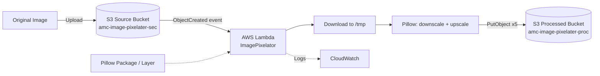

<div align="center">

# 🖼️ Event-Driven Image Pixelation Pipeline

### Serverless image processing with AWS Lambda, Amazon S3 and Python (Pillow)


<br/>


</div>

---

## 📑 Table of Contents

- [Overview](#-overview)
- [Key Features](#-key-features)
- [Architecture](#-architecture)
- [Tech Stack](#-tech-stack)
- [Repository Structure](#-repository-structure)
- [Prerequisites](#-prerequisites)
- [Setup and Deployment](#-setup-and-deployment)
- [How the Pixelation Works](#-how-the-pixelation-works)
- [Testing the Pipeline](#-testing-the-pipeline)
- [Troubleshooting](#-troubleshooting)
- [Security Best Practices](#-security-best-practices)
- [Future Improvements](#-future-improvements)
- [Learning Outcomes](#-learning-outcomes)
- [Acknowledgements](#-acknowledgements)

---

## 📌 Overview

This project is a **fully serverless, event-driven image-processing pipeline** on AWS. When an image is uploaded to a source S3 bucket, an S3 event triggers an AWS Lambda function. The function downloads the image, generates **five pixelated versions** (8×8, 16×16, 32×32, 48×48 and 64×64) using Pillow, and uploads them to a separate processed bucket.

There are no servers to manage, it scales automatically with upload volume, and you pay only for actual execution time.

## ✨ Key Features

| Feature | Description |
|---|---|
| ⚡ **Event-driven** | Processing starts automatically when an object is created in the source bucket |
| 🎛️ **Five pixelation levels** | 8×8, 16×16, 32×32, 48×48 and 64×64 outputs for every upload |
| ☁️ **Serverless** | AWS Lambda execution with no dedicated infrastructure |
| 🪣 **Decoupled storage** | Separate source and processed buckets prevent recursive triggers |
| 🛡️ **Error handling** | Handles failures during object access, download, pixelation and upload |
| ⚙️ **Configurable** | Destination bucket is set through a Lambda environment variable |
| 📈 **Observable** | Execution logs and metrics available in Amazon CloudWatch |

## 🏗️ Architecture



**Workflow**

1. An image is uploaded to the source S3 bucket.
2. S3 emits an `ObjectCreated` event.
3. Lambda receives the event and reads the source bucket name and object key.
4. The original image is downloaded to the temporary `/tmp` directory.
5. Pillow downsizes the image to five small resolutions, then enlarges each back with nearest-neighbor interpolation.
6. The five pixelated images are uploaded to the processed bucket.

## 🧰 Tech Stack

| Technology | Purpose |
|---|---|
| **Python 3.11** | Lambda runtime |
| **AWS Lambda** | Serverless compute |
| **Amazon S3** | Storage for original and processed images |
| **Pillow (PIL)** | Image manipulation |
| **Boto3** | AWS SDK for Python |
| **Amazon CloudWatch** | Logging, monitoring and debugging |
| **AWS IAM** | Least-privilege access control |

## 📁 Repository Structure

```text
image-pixelater-aws-project/
├── assets/
│   └── architecture.svg      # Animated architecture diagram
├── lambda_function.py        # Lambda handler and pixelation logic
├── README.md
└── .gitignore
```

> Pillow is not committed to the repository. It is bundled into the deployment ZIP or supplied through a compatible Lambda layer.

## ✅ Prerequisites

- An AWS account with access to S3, Lambda, IAM and CloudWatch
- Two S3 buckets in the **same Region** (source and processed)
- A Lambda function using **Python 3.11**
- A Pillow build compatible with the Lambda runtime and architecture (`x86_64`)
- An IAM execution role with the S3 permissions below

## 🚀 Setup and Deployment

### Step 1: Create the S3 buckets

| Bucket | Purpose |
|---|---|
| `amc-image-pixelater-sec` | Source: original image uploads |
| `amc-image-pixelater-proc` | Destination: pixelated outputs |

> S3 bucket names are globally unique. Replace these with your own names if they are already taken.

### Step 2: Create the Lambda function

1. Open **AWS Lambda** in the console and choose **Create function**.
2. Name it `ImagePixelator`.
3. Select **Python 3.11** and architecture **x86_64**.
4. Attach an IAM execution role (see Step 6).

### Step 3: Set the environment variable

Go to **Lambda → Configuration → Environment variables**:

| Key | Value |
|---|---|
| `processed_bucket` | `amc-image-pixelater-proc` |

### Step 4: Build and upload the deployment package

Pillow includes compiled components, so build it for the Lambda platform. In **AWS CloudShell**:

```bash
mkdir -p ~/ImagePixelatorBuild/package
cd ~/ImagePixelatorBuild

python3 -m pip install \
  --platform manylinux2014_x86_64 \
  --implementation cp \
  --python-version 3.11 \
  --abi cp311 \
  --only-binary=:all: \
  --target ~/ImagePixelatorBuild/package \
  Pillow
```

Copy `lambda_function.py` into the `package` folder, then create the ZIP:

```bash
cd ~/ImagePixelatorBuild/package
zip -r ~/ImagePixelator-deployment.zip .
```

Upload it via **Lambda → ImagePixelator → Code → Upload from → .zip file**.
The ZIP root must contain `lambda_function.py` and the `PIL` package.

> Alternatively, use a Lambda layer built for the same runtime and architecture, and avoid bundling a second Pillow copy in the function package.

### Step 5: Add the S3 trigger

On the `ImagePixelator` function, add an S3 trigger:

- **Bucket:** `amc-image-pixelater-sec`
- **Event type:** All object create events
- **Prefix/suffix:** optional filters for allowed file types

> ⚠️ Never attach this trigger to the processed bucket. That would cause recursive invocations.

### Step 6: Configure IAM permissions

```json
{
  "Version": "2012-10-17",
  "Statement": [
    {
      "Effect": "Allow",
      "Action": ["s3:GetObject"],
      "Resource": "arn:aws:s3:::amc-image-pixelater-sec/*"
    },
    {
      "Effect": "Allow",
      "Action": ["s3:PutObject"],
      "Resource": "arn:aws:s3:::amc-image-pixelater-proc/*"
    }
  ]
}
```

Also attach a CloudWatch Logs policy (for example `AWSLambdaBasicExecutionRole`). If your buckets use customer-managed KMS keys, add the required KMS permissions.

## 🎨 How the Pixelation Works

Each image is processed with two resize operations:

1. **Downscale:** the image is shrunk to a tiny resolution using bilinear interpolation.
2. **Upscale:** it is enlarged back to the original dimensions using **nearest-neighbor** interpolation, which produces hard-edged blocks.

| Output prefix | Intermediate resolution |
|---|---:|
| `pixelated-8x8-` | 8 × 8 |
| `pixelated-16x16-` | 16 × 16 |
| `pixelated-32x32-` | 32 × 32 |
| `pixelated-48x48-` | 48 × 48 |
| `pixelated-64x64-` | 64 × 64 |

Uploading `originalimage.jpeg` produces:

```text
pixelated-8x8-originalimage.jpeg
pixelated-16x16-originalimage.jpeg
pixelated-32x32-originalimage.jpeg
pixelated-48x48-originalimage.jpeg
pixelated-64x64-originalimage.jpeg
```

Output images keep the original dimensions. Only the visual detail level changes.

## 🧪 Testing the Pipeline

1. Upload an image (for example `originalimage.jpeg`) to `amc-image-pixelater-sec`.
2. Open **Lambda → ImagePixelator → Monitor** and confirm an invocation with no errors.
3. Check the CloudWatch log group `/aws/lambda/ImagePixelator`.
4. Refresh `amc-image-pixelater-proc` and verify the five output images.

> Objects uploaded before the trigger existed are not processed retroactively. Re-upload them or invoke the function with a test S3 event.

## 🛠️ Troubleshooting

| Error or symptom | Likely cause | What to check |
|---|---|---|
| `No module named 'PIL'` | Pillow missing from the package | ZIP contents or attached layer |
| `cannot import name '_imaging' from 'PIL'` | Incompatible or conflicting Pillow files | Rebuild a clean package for the runtime and architecture |
| `AccessDenied` | Missing S3 permissions | Execution role and bucket policies |
| No Lambda invocation | Trigger missing or misconfigured | S3 event notification on the source bucket |
| Invocation succeeds, no output | Wrong destination bucket or upload logic | Environment variable and CloudWatch logs |
| `Error pixelating image` | Corrupted or unsupported input | Input file and Pillow compatibility |
| Timeout | Processing exceeds configured limit | Lambda timeout and memory settings |

## 🔐 Security Best Practices

- Keep S3 buckets **private** unless public access is explicitly required.
- Apply **least-privilege** IAM policies.
- Never commit AWS access keys or secrets. Use environment variables for non-secret configuration.
- Validate image type and file size before processing.
- Do not trigger the function on its own output bucket.
- Monitor Lambda logs and AWS costs.

> **Note:** Pixelation is not a reliable way to anonymize sensitive information, as details can sometimes be inferred from the output.

## 🔮 Future Improvements

- [ ] Support additional formats (JPEG, PNG, WebP) with content-type validation
- [ ] Input size and type validation before processing
- [ ] Unit tests for the pixelation logic
- [ ] Structured logging and clearer error reporting
- [ ] Amazon SQS buffering for high-volume workloads
- [ ] CloudWatch alarms for failed executions
- [ ] Infrastructure as Code with AWS SAM, CDK or Terraform
- [ ] CI/CD pipeline for automated deployment

## 🎓 Learning Outcomes

- Event-driven serverless architecture on AWS
- S3 event notifications and cross-bucket workflows
- Lambda packaging, deployment and configuration
- Python image manipulation with Pillow
- IAM roles and least-privilege access
- Monitoring and debugging with CloudWatch
- Building Python dependencies for a Linux-based cloud runtime

## 🙏 Acknowledgements

This project was built by following and adapting the public tutorial repository [yeshwanthlm/image-pixelater-aws-project](https://github.com/yeshwanthlm/image-pixelater-aws-project). The original used Python 3.9 and different bucket names. This version documents the Python 3.11 setup, an updated Pillow build process and the bucket names from my own deployment.

## 👤 Author

**Ishita**
B.Tech, Computer and Communication Engineering, Manipal Institute of Technology

[](https://github.com/YourUsername)
[](https://www.linkedin.com/in/your-profile)

## 📄 License

Add a `LICENSE` file if you plan to share or reuse this project, and check the original repository's licensing terms before redistributing its code.
